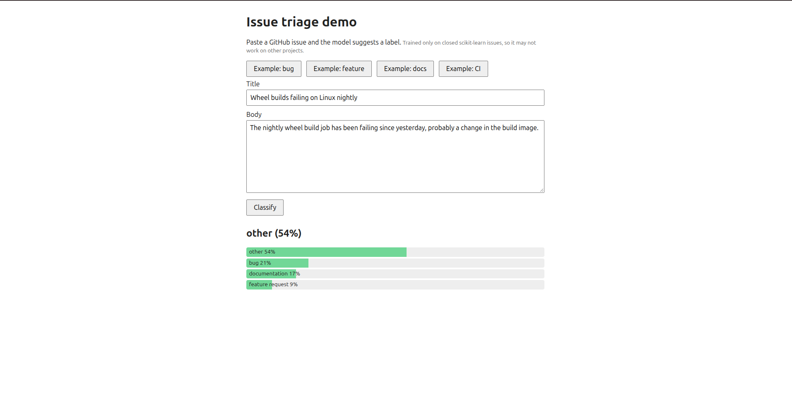
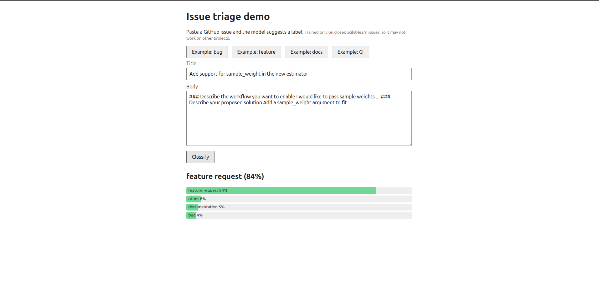
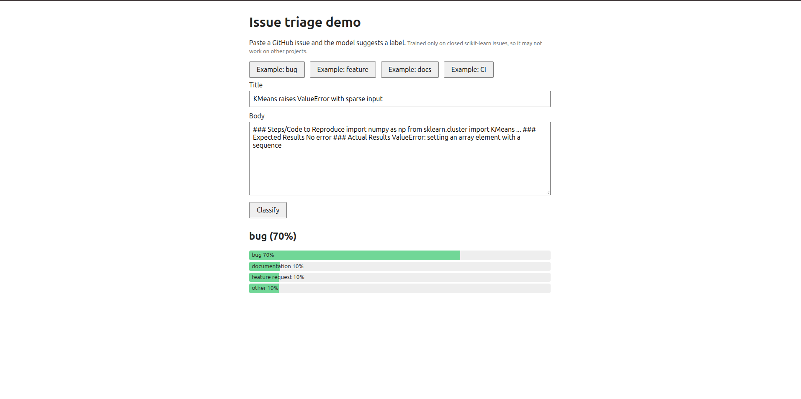
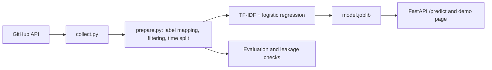

# Issue Triage Classifier

I built a classifier that suggests a label (bug, feature request, documentation or other) for a new GitHub issue. It is meant for maintainers who spend time sorting incoming issues. It is trained on about 1,000 closed [scikit-learn](https://github.com/scikit-learn/scikit-learn) issues, and I used it to answer one question: is a heavier model worth it over a simple baseline?

## Demo

Run it locally (see [Try it](#try-it)) and open http://127.0.0.1:8000.

| Example 1 | Example 2 | Example 3 |
|---|---|---|
|  |  |  |

## How it fits together



## What I found

- **The simple model won.** TF-IDF with logistic regression reached 87% accuracy, against 72% for sentence embeddings, and it is about 70x faster (0.9 ms vs 65 ms per issue).
- **The 87% needs a caveat.** Most scikit-learn issues are filed with a template, and the template headings point almost straight at the label (93-99% of the time). On test issues without a template heading, accuracy was 72%. That group is small and mostly "other", so class mix plays a part too, but part of the score is the model reading what the reporter chose.
- **I added a "needs review" flag.** At a 0.5 confidence threshold, about a third of test issues (32%) go to a human, and the rest are 95% accurate.

## Design decisions

- **Time-based split instead of a random one.** A triage tool sees new issues, so the newest 20% is the test set. The cost is a smaller test set whose class mix shifts (more "other" issues).
- **TF-IDF over embeddings.** It scored higher and is much faster. The cost is that it only sees words, though I only tested one frozen embedding model.
- **Ship the full-text model, but report the stripped one too.** Templates are present when a real issue arrives, but the model is weaker without them, so both numbers are shown.
- **A review flag instead of always answering.** Low-confidence predictions go to a human. The cost is that about a third of issues still need a person.

## Results

Test set: 202 issues from after the training period (about ±5 points of uncertainty on accuracy).

| Model | Input | Accuracy | Macro F1 | ms/issue |
|---|---|---|---|---|
| TF-IDF + LR (shipped) | full text | 0.866 | 0.863 | 0.9 |
| TF-IDF + LR | template stripped | 0.752 | 0.709 | 0.8 |
| MiniLM embeddings + LR | full text | 0.723 | 0.697 | 64.9 |
| MiniLM embeddings + LR | template stripped | 0.668 | 0.630 | 63.5 |

Latency is the average over the test set on a laptop CPU, measured in batches, so single-request times will differ.

Per-class recall for the shipped model: bug 0.859 (99 test issues), documentation 0.975 (40), feature request 1.000 (24), other 0.692 (39). Small classes mean wide uncertainty.

The embedding result is for one frozen, off-the-shelf encoder (`all-MiniLM-L6-v2`) with 804 training examples. It does not show that embeddings can't work.

## How it was built

- **Data:** the 1,500 most recent closed scikit-learn issues (pull requests excluded; usernames and emails not stored), collected with `src/collect.py`. Raw data hash: `3bcd198eff34`.
- **Labels:** maintainer labels mapped to four classes (see `LABEL_MAP` in `src/prepare.py`). "other" groups CI, performance, RFC, Array API, Cython and API labels.
- **Filtering:** 1,006 issues kept. Dropped: 398 unlabeled, 73 with labels from more than one class, 22 spam, 1 duplicate.
- **Split:** by time. The oldest 80% (804 issues, up to 2025-11-10) train; the newest 20% (202 issues, from 2025-11-11) test.
- **Model:** TF-IDF (1-2 grams, `min_df=2`, sublinear TF) + logistic regression with balanced class weights, seed 42, Python 3.12, scikit-learn 1.9.1.

### Checks against leakage (`src/sanity_checks.py`)

- Train ends before test begins, with no shared issue IDs and no exact duplicate texts.
- 1 of 202 test issues shares its first 60 characters with a training issue.
- Shuffled-label test: real labels score 0.87, shuffled training labels score 0.40.

### Template and title-tag dependence

| Signal | Issues | Label purity |
|---|---|---|
| Documentation template heading | 177 | 175 documentation (99%) |
| Bug template heading | 455 | 422 bug (93%) |
| Feature template heading | 159 | 148 feature request (93%) |
| Title tags such as DOC, BUG, ENH, CI, RFC | 160 (16%) | mostly one class each |

72-80% of issues contain a template heading. A reporter choosing a template is real signal at triage time, but the model is partly reading that choice. The "stripped" input removes body headings and boilerplate; title tags remain. On test issues with a template heading, the full-text model scored 92.4% (145 issues); on issues without one, 71.9% (57 issues, mostly "other").

### Review threshold (`src/threshold_check.py`)

Chosen with 5-fold cross-validation on the training set and confirmed on test. At 0.5, test flags 32% of issues for human review (69% of those are actually correct), and the unflagged ones are 95% accurate. Change it with the `REVIEW_THRESHOLD` environment variable.

### Error analysis

50 test errors from the template-stripped TF-IDF model, categorized by hand: 23 model errors, 18 ambiguous, 8 where the maintainer label looks wrong, 1 with no content.

## Limitations

- One repository, closed issues only. It may not work on other projects.
- 494 of 1,500 issues were excluded, including 398 with no usable label, which is the kind of issue a triage tool most needs to handle.
- Labels are the final maintainer labels, not what was known at triage time.
- Small test set, and four variants were compared on the same test set.
- Label noise has not been measured yet. A 160-issue blind review sample is set up (`src/make_review_sample.py`, `src/compare_review.py`).

## Try it

```bash
python3 -m venv .venv && source .venv/bin/activate
pip install -r requirements-dev.txt

mkdir -p data
# optional but recommended: put GITHUB_TOKEN=... in a .env file (never commit it)
python3 src/collect.py scikit-learn/scikit-learn

bash run_all.sh        # prepare, sanity checks, compare models, threshold check, train, tests
```

`run_all.sh` creates `models/model.joblib`. The comparison step downloads a sentence-transformers model and takes a few minutes. The API alone only needs `requirements.txt`.

```bash
uvicorn api.main:app --reload
# demo page: http://127.0.0.1:8000   API docs: http://127.0.0.1:8000/docs
```

```bash
curl -X POST http://127.0.0.1:8000/predict \
  -H "Content-Type: application/json" \
  -d '{"title": "KMeans raises ValueError with sparse input", "body": ""}'
```

## Layout

```
api/main.py            FastAPI service and demo page
src/                   data collection, preparation, experiments, training
tests/                 API tests
docs/                  demo screenshots
requirements.txt       runtime dependencies (API)
requirements-dev.txt   training and experiment dependencies
run_all.sh             full pipeline
```